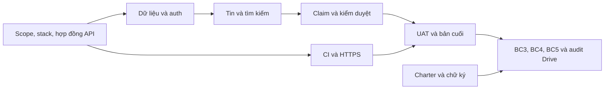

# M2 — WBS & Sprint 1 Setup

**v0.3, 02/11/2026 — dự thảo theo hạn trước 16/11, chưa khóa baseline.** TV2 chủ trì BC2; TV1 xác nhận scope/năng lực; TV3–TV5 ước lượng phần mình. Mục tiêu bản nhóm thống nhất: 04/11.

## 1. Cách dùng

M2 cung cấp WBS & Dictionary cho **BC2**; bảng giao việc thực thi tại [21 issue LF](../03-yeu-cau/board-tasks-2026-11-15.md). Hạn cuối trước thứ Hai 16/11; chọn 20:00 Chủ nhật 15/11 làm mốc nội bộ. Người dùng đã xác nhận phải đủ 5 báo cáo và sản phẩm HTTPS/APK trước hạn; kế hoạch chọn web HTTPS và không tự miễn yêu cầu khi lịch ngắn.

MVP rút gọn đang đề xuất để chốt với nhóm/PO: tài khoản thử, tin văn bản, tìm kiếm từ khóa/loại/khu vực, yêu cầu nhận đồ riêng, moderator xác minh thực tế rồi ghi nhận bàn giao, ẩn/khôi phục tin. Hoãn ảnh/lọc nâng cao và nhiều tầng phê duyệt; giữ kiểm tra quyền, HTTPS và hồ sơ. [Backlog/AC](../03-yeu-cau/backlog-va-nghiem-thu.md) là bản nghiệp vụ chi tiết.

## 2. WBS theo sản phẩm bàn giao

```text
0. School Lost & Found — MVP HTTPS và 5 báo cáo trên Drive
├── 1. Hồ sơ quản trị và chất lượng
│   ├── 1.1. Charter đã ký, stakeholder và nơi nộp Drive
│   ├── 1.2. WBS/Dictionary, quyết định stack và baseline GitHub
│   └── 1.3. Hồ sơ theo dõi và kiểm chứng
│       ├── 1.3.1. AC/test, baseline và kết quả Sprint 1 / risk update #1
│       └── 1.3.2. Health Check, UAT, risk update #2 và audit evidence
├── 2. Nền tảng kỹ thuật
│   ├── 2.1. Dữ liệu, tài khoản thử và quyền truy cập
│   └── 2.2. CI và môi trường HTTPS đầu tiên
├── 3. Luồng đăng và tìm tin
│   └── 3.1. Wireframe và API/UI đăng, xem, sửa, tìm tin tích hợp
├── 4. Luồng quản lý đồ và nội dung
│   └── 4.1. Claim, xác nhận bàn giao và kiểm duyệt tối thiểu
└── 5. Bộ bàn giao
    ├── 5.1. BC4: Final Report PDF 15–25 trang và checklist
    ├── 5.2. BC5: 8–10 slide, kịch bản demo và diễn tập
    └── 5.3. Bản HTTPS cuối, runbook và bộ nộp Drive
```

Có **11 nút lá** theo sản phẩm bàn giao, dự kiến hoàn thành trong cửa sổ một tuần như dictionary. Giờ công là effort của nhóm làm bán thời gian, khác với thời gian từ đầu đến cuối gói. Wireframe 4 giờ đã gộp vào gói luồng tích hợp, không tạo work package riêng. Khi TV2 chốt estimate sau spike, kiểm tra lại quy tắc gói 1–2 tuần theo hướng dẫn thầy: gói thực tế quá nhỏ cần gộp, quá lớn cần tách; không chỉ gán khoảng ngày một tuần để kết luận đã đạt. Các nhóm cha không có effort cộng thêm.

## 3. WBS Dictionary và 100% Rule

| WBS | Sản phẩm / phạm vi | Owner / hỗ trợ | Đầu vào/phụ thuộc | Khoảng làm | Giờ công | Điều kiện nghiệm thu / issue |
|---|---|---|---|---|---:|---|
| 1.1 | Nhu cầu, phân vai, Drive và BC1 có chữ ký | TV1 / TV5 | Thông tin thật, PO/GV | 02–08/11 | 10 | M1 đủ 13 mục, chữ ký thật, Drive xem bằng link; LF-01/02 |
| 1.2 | Stack/API contract, GitHub và BC2 baseline | TV2 / TV1, TV3 | Scope bản làm việc, AC | 02–08/11 | 8 | Stack có spike, repo/board dùng được, WBS/estimate được review; LF-05/06 |
| 1.3.1 | AC/test plan, risk baseline, test/review/retro S1 và update #1 | TV5 / cả nhóm | Scope, bản HTTPS S1 | 02–08/11 | 12 | Test và risk update có quan sát/evidence thật; LF-17/18 |
| 1.3.2 | M3, UAT, BC3 update #2/matrix, evidence/rubric audit | TV5 / cả nhóm | Kết quả S1, bản S2, file báo cáo | 09–15/11 | 12 | M3 09/11; hai risk update thật, UAT/acceptance, audit 15/11; LF-19/20/21 |
| 2.1 | Schema/seed, tài khoản thử, auth và quyền server | TV3 / TV2 | Model dự thảo; stack LF-05 để code | 02–08/11 | 8 | Khởi tạo/chạy lại và test quyền đạt; LF-10 |
| 2.2 | CI, cấu hình và HTTPS ban đầu | TV2 / TV3, TV4 | Stack, dữ liệu/API; UI tối thiểu đang phát triển | 02–08/11 | 8 | HTTPS thật và dữ liệu lưu; CI thật; full slice kiểm tra 08/11; LF-07 |
| 3.1 | Wireframe và tin/tìm kiếm: API/UI tích hợp | TV3 / TV4, TV1 | Scope, auth/model; wireframe là bước trong gói | 02–08/11 | 20 | Wireframe được review; tạo/xem/sửa tin của mình, lọc đúng, không chỉ mock; LF-11/13/14 |
| 4.1 | Claim riêng, bàn giao và hide/restore | TV3 / TV2, TV4 | 2.1, 3.1 | 09–15/11 | 16 | Quyền và bàn giao không trùng, UI/API tích hợp; LF-08/12/15 |
| 5.1 | BC4 PDF và checklist báo cáo | TV1 / các thành viên | Kết quả từng ngày, chốt sau review S2 | 09–15/11 | 8 | PDF 15–25 trang kể đúng thực tế; LF-03 |
| 5.2 | BC5 deck/demo và diễn tập | TV4 / cả nhóm | Kết quả/HTTPS, M3, rubric từ TV5 | 09–15/11 | 8 | 8–10 slide, nội dung thật, đã diễn tập; LF-16 |
| 5.3 | Bản HTTPS cuối, runbook và bộ Drive đã audit/nộp | TV2 / TV1, TV5 | Module tích hợp; đóng sau UAT, báo cáo/chữ ký | 09–15/11 | 9 | Runbook/URL/version; đủ bộ và đúng quyền; LF-09/04 |
| | **Tổng** | | | | **119** | |

100% Rule: R01 → 2.1; R02/R03 → 3.1; R04/R05/R06 → 4.1; R07 → 2.2/1.3.1/1.3.2/5.3. BC1 → 1.1; BC2 → 1.2; BC3 → 1.3.1/1.3.2; BC4 → 5.1; BC5 → 5.2 và phần self-assessment của 1.3.2. AI/change/retro nằm trong hồ sơ 1.3.x; final retrospective và acceptance trong LF-20, bằng chứng AI do người dùng công cụ ghi hằng ngày và TV5 tổng hợp ở LF-21. Không có gói chức năng ngoài scope.

Test module tính trong issue tác giả; test tích hợp/UAT riêng ở 1.3.x. 2.2 thiết lập HTTPS ban đầu, 5.3 chốt bản cuối và nơi nộp; không tính việc đó hai lần. TV1 tổng hợp BC4 từ đóng góp kỹ thuật thực tế đã nằm trong các issue, không viết lại toàn bộ đầu ra thay mọi người.

## 4. Năng lực và tính khả thi

| Người | Tuần 02–08/11 | Tuần 09–15/11 | Tổng việc | Năng lực 2 tuần giả định | Còn cho họp/review/phát sinh |
|---|---:|---:|---:|---:|---:|
| TV1 | 10 | 12 | 22 | 30 | 8 |
| TV2 | 16 | 9 | 25 | 30 | 5 |
| TV3 | 16 | 8 | 24 | 30 | 6 |
| TV4 | 12 | 12 | 24 | 30 | 6 |
| TV5 | 12 | 12 | 24 | 30 | 6 |
| **Tổng** | **66** | **53** | **119** | **150** | **31** |

30 giờ/người trong hai tuần là giả định, chưa được từng người cam kết. TV2/TV3 cần dành nhiều hơn ở tuần đầu hoặc ghép người hỗ trợ; bình quân 15 giờ/tuần không có nghĩa mọi tuần đều đúng 15 giờ. Nếu chỉ có 12 giờ/tuần/người thì tổng 120 giờ hầu như không đủ review/phát sinh. Chốt lại estimate sau spike 03/11; không xem số này là bảo đảm kịp hạn.

Bản v0.2 212 giờ dùng scope và lịch rộng hơn. v0.3 là **đề xuất scope rút gọn + chia lại việc**, chưa được PO xác nhận; không phải năng suất tăng được chứng minh. Chưa có stakeholder/kỹ năng/stack thì rủi ro vẫn cao. Nếu thiếu năng lực, TV1 trao đổi sớm để giảm scope không bắt buộc hoặc xử lý hạn với thầy; không tự bỏ gate HTTPS/Drive/chữ ký.

## 5. Sprint và các mốc kiểm soát

- **S1 02–08/11:** nền quản trị, auth, tin/tìm kiếm, HTTPS, test/review/risk update #1. BC1 mục tiêu ký 05/11; BC2 baseline 04/11.
- **M3 giữa kỳ 09/11:** dùng cutoff hết 08/11, chỉ kết luận từ thực tế, quyết định ưu tiên tuần cuối.
- **S2 09–15/11:** claim/bàn giao/kiểm duyệt, UAT, risk update #2 sáng 15/11, BC4/BC5 và bàn giao. Hết 12/11 khóa thêm tính năng.
- **15/11:** review S2/BC3 trước 12:00; BC4 trước 16:00; audit trước 18:00; nộp mục tiêu 20:00. Những giờ này là mốc nội bộ đề xuất.

Không có công việc cần thiết nào được xếp sau 15/11. Week 6/11 chỉ giữ là chú thích tuần học, không ghi hai tuần tháng 11 thành lịch sử cả học kỳ.

## 6. Phụ thuộc và baseline



UI/mock và test plan làm song song dựa trên hợp đồng; chỉ gọi tích hợp hoàn tất khi dữ liệu thật chạy. LF-07 có bản nền/API HTTPS ngày 07/11; LF-14/18 hoàn thành kiểm tra luồng có UI ngày 08/11. Báo cáo/slide dựng dần từ đầu tuần 2, chỉ chốt kết luận khi có kết quả cuối.

Chậm nhất 04/11 chốt baseline có ngày thật: danh sách LF → URL issue, estimate, owner, scope được nhóm xác nhận và snapshot board. Trước đó là dự thảo. Nếu đã tạo issue S1-xx, giữ lịch sử và ánh xạ sang việc mới; không tạo trùng effort. Không hồi tố baseline vào trước ngày chốt.

## 7. Ready/Done và giao việc

Todo (= Ready) khi phần việc bắt đầu có đầu vào, owner, AC, estimate/hạn và reviewer. Chọn 5 thẻ khởi động trong [trang gửi nhóm](../../BAT-DAU-TU-DAY.md); LF-10 bắt đầu model trên giấy, code chờ stack. Mỗi người tối đa một việc chính In Progress. Blocker ghi trong issue/label và báo TV1 sau một buổi không gỡ được.

Done cần đầu ra, tự kiểm tra, peer review và evidence; code có CI phù hợp/pass và merge; tài liệu không biến chỗ trống thành dữ kiện. Charter phải có chữ ký thật mới hoàn thành BC1. Report chỉ tích trong form khi đã đầy đủ và có trên Drive. Review/risk vẫn thực hiện nếu sprint không đạt, ghi đúng thất bại/blocker; không giả số liệu để đóng việc.
