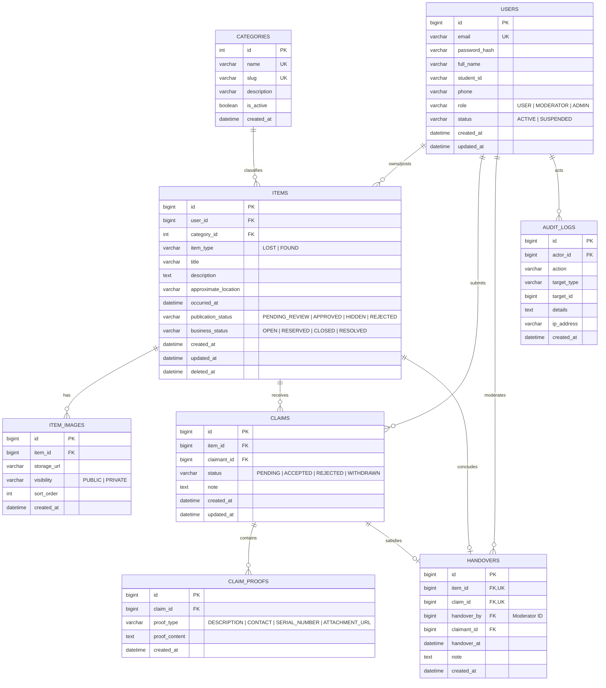

# LF-10 — Thiết kế mô hình dữ liệu, dữ liệu mẫu (Seed Data) và cơ chế xác thực tài khoản

> **Tài liệu thuộc giai đoạn:** [Design] / [Requirements]  
> **Mã công việc WBS:** 2.1 — Cơ sở dữ liệu và Xác thực (Sprint 1: 02/11/2026 – 08/11/2026)  
> **Issue theo dõi:** [#3 — LF-10](https://github.com/imduw/school-lost-found/issues/3)  
> **Người thực hiện (Owner):** TV3 — Dữ liệu & Backend (@dxhai17)  
> **Người kiểm tra (Reviewer):** TV2 — Kỹ thuật & WBS (@imduw)  
> **Hạn hoàn thành:** 05/11/2026  
> **Trạng thái:** Hoàn tất tài liệu đặc tả, schema DDL, seed script và kịch bản kiểm thử (Sẵn sàng Review & Nghiệm thu)

---

## 1. Mục tiêu và phạm vi của LF-10

Tài liệu này đặc tả chi tiết mô hình dữ liệu quan hệ, bộ dữ liệu khởi tạo thử nghiệm (seed data), và kiến trúc xác thực/phân quyền (Auth & RBAC) cho hệ thống **School Lost & Found (VKU)** nhằm:
1. Đảm bảo chuẩn hóa cơ sở dữ liệu dùng chung cho cả Web Client (React) và Backend REST API (Spring Boot/Node.js) đã thống nhất tại LF-05.
2. Cung cấp bộ dữ liệu mẫu (seed data) có nhãn thử nghiệm rõ ràng, đầy đủ các trường hợp để các thành viên khác (TV4 làm giao diện LF-14, TV5 làm kiểm thử LF-17/18, TV2 thiết lập HTTPS LF-07) có thể chạy và tái lập môi trường ngay lập tức mà không phụ thuộc lẫn nhau.
3. Hiện thực hóa các quy tắc nghiệp vụ cốt lõi: bảo mật thông tin đối chiếu (Proof Privacy), chống xung đột bàn giao đồng thời (Concurrency Control), và phân quyền kiểm tra phía máy chủ (Server-side RBAC).

---

## 2. Mô hình quan hệ thực thể (ERD & Data Model)

### 2.1 Sơ đồ thực thể quan hệ (Mermaid ERD)



---

### 2.2 Từ điển dữ liệu (Data Dictionary)

#### 1. Bảng `users` (Người dùng & Tài khoản)
Lưu trữ thông tin xác thực và hồ sơ người dùng trong khuôn viên trường.

| Tên cột | Kiểu dữ liệu | Ràng buộc | Mô tả |
|---|---|---|---|
| `id` | `BIGINT` | `PK, AUTO_INCREMENT` | Định danh người dùng |
| `email` | `VARCHAR(120)` | `NOT NULL, UNIQUE` | Email trường (@vku.udn.vn) hoặc email đăng nhập |
| `password_hash` | `VARCHAR(255)` | `NOT NULL` | Mật khẩu băm (BCrypt cost factor 10), tuyệt đối không lưu plain text |
| `full_name` | `VARCHAR(100)` | `NOT NULL` | Họ và tên sinh viên / cán bộ |
| `student_id` | `VARCHAR(30)` | `NULL` | Mã số sinh viên (nếu là sinh viên) |
| `phone` | `VARCHAR(20)` | `NULL` | Số điện thoại liên hệ (chỉ lộ khi được phép) |
| `role` | `VARCHAR(20)` | `NOT NULL, DEFAULT 'USER'` | Vai trò: `USER`, `MODERATOR`, `ADMIN` |
| `status` | `VARCHAR(20)` | `NOT NULL, DEFAULT 'ACTIVE'` | Trạng thái: `ACTIVE`, `SUSPENDED` |
| `created_at` | `DATETIME` | `NOT NULL, DEFAULT CURRENT_TIMESTAMP` | Thời điểm tạo |
| `updated_at` | `DATETIME` | `NOT NULL, DEFAULT CURRENT_TIMESTAMP ON UPDATE` | Thời điểm cập nhật |

#### 2. Bảng `categories` (Danh mục tài sản)
Phân loại đồ thất lạc để hỗ trợ tìm kiếm và lọc.

| Tên cột | Kiểu dữ liệu | Ràng buộc | Mô tả |
|---|---|---|---|
| `id` | `INT` | `PK, AUTO_INCREMENT` | Mã danh mục |
| `name` | `VARCHAR(100)` | `NOT NULL, UNIQUE` | Tên danh mục (Ví tiền, Điện thoại/Laptop, Thẻ/Giấy tờ, Balo/Cặp sách, Khác) |
| `slug` | `VARCHAR(100)` | `NOT NULL, UNIQUE` | Đường dẫn rút gọn phục vụ URL/API |
| `description` | `VARCHAR(255)` | `NULL` | Mô tả phạm vi danh mục |
| `is_active` | `BOOLEAN` | `NOT NULL, DEFAULT TRUE` | Trạng thái hoạt động |
| `created_at` | `DATETIME` | `NOT NULL, DEFAULT CURRENT_TIMESTAMP` | Thời điểm tạo |

#### 3. Bảng `items` (Tin báo Mất / Nhặt được đồ)
Thực thể trung tâm lưu thông tin bài đăng đồ thất lạc.

| Tên cột | Kiểu dữ liệu | Ràng buộc | Mô tả |
|---|---|---|---|
| `id` | `BIGINT` | `PK, AUTO_INCREMENT` | Mã tin đăng |
| `user_id` | `BIGINT` | `NOT NULL, FK -> users(id)` | Người đăng tin |
| `category_id` | `INT` | `NOT NULL, FK -> categories(id)` | Danh mục tài sản |
| `item_type` | `VARCHAR(10)` | `NOT NULL` | Loại tin: `LOST` (Báo mất) hoặc `FOUND` (Nhặt được) |
| `title` | `VARCHAR(200)` | `NOT NULL` | Tiêu đề tin đăng (ngắn gọn, xúc tích) |
| `description` | `TEXT` | `NOT NULL` | Mô tả đặc điểm công khai (màu sắc, vị trí tổng quát) |
| `approximate_location`| `VARCHAR(200)`| `NOT NULL` | Khu vực xảy ra (ví dụ: Giảng đường V, Thư viện tầng 2, Căn tin) |
| `occurred_at` | `DATETIME` | `NOT NULL` | Thời gian mất hoặc nhặt được |
| `publication_status` | `VARCHAR(20)` | `NOT NULL, DEFAULT 'APPROVED'` | Trạng thái hiển thị: `PENDING_REVIEW`, `APPROVED`, `HIDDEN`, `REJECTED` |
| `business_status` | `VARCHAR(20)` | `NOT NULL, DEFAULT 'OPEN'` | Trạng thái nghiệp vụ: `OPEN`, `RESERVED`, `CLOSED`, `RESOLVED` |
| `created_at` | `DATETIME` | `NOT NULL, DEFAULT CURRENT_TIMESTAMP` | Thời điểm tạo tin |
| `updated_at` | `DATETIME` | `NOT NULL, DEFAULT CURRENT_TIMESTAMP ON UPDATE` | Thời điểm sửa đổi |
| `deleted_at` | `DATETIME` | `NULL` | Soft delete (nếu có) |

#### 4. Bảng `item_images` (Hình ảnh đính kèm bài đăng)
Lưu URL hình ảnh (lưu ngoài Cloudinary/Storage). Trong MVP rút gọn tính năng upload ảnh bị hoãn, nhưng bảng này sẵn sàng nhận URL ảnh mẫu/placeholder.

| Tên cột | Kiểu dữ liệu | Ràng buộc | Mô tả |
|---|---|---|---|
| `id` | `BIGINT` | `PK, AUTO_INCREMENT` | Mã ảnh |
| `item_id` | `BIGINT` | `NOT NULL, FK -> items(id)` | Bài đăng sở hữu |
| `storage_url` | `VARCHAR(500)` | `NOT NULL` | Link ảnh công khai hoặc ảnh placeholder |
| `visibility` | `VARCHAR(20)` | `NOT NULL, DEFAULT 'PUBLIC'` | `PUBLIC` hoặc `PRIVATE` |
| `sort_order` | `INT` | `NOT NULL, DEFAULT 0` | Thứ tự hiển thị |
| `created_at` | `DATETIME` | `NOT NULL, DEFAULT CURRENT_TIMESTAMP` | Thời điểm thêm |

#### 5. Bảng `claims` (Yêu cầu nhận lại đồ)
Lưu yêu cầu của người nhận là chủ sở hữu đối với một tin `FOUND`.

| Tên cột | Kiểu dữ liệu | Ràng buộc | Mô tả |
|---|---|---|---|
| `id` | `BIGINT` | `PK, AUTO_INCREMENT` | Mã yêu cầu nhận đồ |
| `item_id` | `BIGINT` | `NOT NULL, FK -> items(id)` | Tin đăng nhặt được được yêu cầu |
| `claimant_id` | `BIGINT` | `NOT NULL, FK -> users(id)` | Người gửi yêu cầu nhận đồ |
| `status` | `VARCHAR(20)` | `NOT NULL, DEFAULT 'PENDING'` | Trạng thái: `PENDING`, `ACCEPTED`, `REJECTED`, `WITHDRAWN` |
| `note` | `TEXT` | `NULL` | Ghi chú của Moderator khi duyệt/từ chối |
| `created_at` | `DATETIME` | `NOT NULL, DEFAULT CURRENT_TIMESTAMP` | Thời điểm tạo claim |
| `updated_at` | `DATETIME` | `NOT NULL, DEFAULT CURRENT_TIMESTAMP ON UPDATE` | Thời điểm xử lý claim |

#### 6. Bảng `claim_proofs` (Bằng chứng sở hữu bảo mật)
Chứa các thông tin nhạy cảm (mã sinh viên trong ví, số serial, mật khẩu màn hình khóa, đặc điểm nhận dạng ẩn) để đối chiếu trực tiếp.

| Tên cột | Kiểu dữ liệu | Ràng buộc | Mô tả |
|---|---|---|---|
| `id` | `BIGINT` | `PK, AUTO_INCREMENT` | Mã bằng chứng |
| `claim_id` | `BIGINT` | `NOT NULL, FK -> claims(id)` | Yêu cầu sở hữu |
| `proof_type` | `VARCHAR(30)` | `NOT NULL` | Loại: `DESCRIPTION`, `CONTACT`, `SERIAL_NUMBER`, `ATTACHMENT_URL` |
| `proof_content` | `TEXT` | `NOT NULL` | Nội dung bằng chứng (BẢO MẬT: Chỉ Claimant và Moderator được xem) |
| `created_at` | `DATETIME` | `NOT NULL, DEFAULT CURRENT_TIMESTAMP` | Thời điểm nộp bằng chứng |

#### 7. Bảng `handovers` (Biên bản ghi nhận bàn giao đồ)
Lưu bằng chứng hoàn tất việc trao trả tài sản thực tế giữa Moderator và Người nhận.

| Tên cột | Kiểu dữ liệu | Ràng buộc | Mô tả |
|---|---|---|---|
| `id` | `BIGINT` | `PK, AUTO_INCREMENT` | Mã biên bản bàn giao |
| `item_id` | `BIGINT` | `NOT NULL, UNIQUE, FK -> items(id)` | Mỗi món đồ chỉ được bàn giao thành công tối đa 1 lần |
| `claim_id` | `BIGINT` | `NOT NULL, UNIQUE, FK -> claims(id)` | Claim được chấp thuận bàn giao |
| `handover_by` | `BIGINT` | `NOT NULL, FK -> users(id)` | Moderator xác nhận đã giao đồ |
| `claimant_id` | `BIGINT` | `NOT NULL, FK -> users(id)` | Người thực tế đã nhận lại đồ |
| `handover_at` | `DATETIME` | `NOT NULL` | Thời điểm thực tế trao đồ tại văn phòng |
| `note` | `TEXT` | `NULL` | Ghi chú bàn giao (ví dụ: đã kiểm tra CCCD/Thẻ SV) |
| `created_at` | `DATETIME` | `NOT NULL, DEFAULT CURRENT_TIMESTAMP` | Thời điểm tạo biên bản |

#### 8. Bảng `audit_logs` (Nhật ký kiểm toán hệ thống)
Lưu vết các thao tác quản trị: ẩn tin, mở tin, duyệt bàn giao đồ, khóa tài khoản.

| Tên cột | Kiểu dữ liệu | Ràng buộc | Mô tả |
|---|---|---|---|
| `id` | `BIGINT` | `PK, AUTO_INCREMENT` | Mã nhật ký |
| `actor_id` | `BIGINT` | `NOT NULL, FK -> users(id)` | Người thực hiện thao tác |
| `action` | `VARCHAR(50)` | `NOT NULL` | Hành động (`HIDE_ITEM`, `RESTORE_ITEM`, `COMPLETE_HANDOVER`,...) |
| `target_type` | `VARCHAR(30)` | `NOT NULL` | Bảng đối tượng (`ITEM`, `CLAIM`, `USER`) |
| `target_id` | `BIGINT` | `NOT NULL` | ID đối tượng bị tác động |
| `details` | `TEXT` | `NULL` | Chi tiết lý do hoặc payload trước/sau |
| `ip_address` | `VARCHAR(45)` | `NULL` | Địa chỉ IP của client |
| `created_at` | `DATETIME` | `NOT NULL, DEFAULT CURRENT_TIMESTAMP` | Thời điểm ghi log |

---

## 3. Máy trạng thái (State Machine) & Quy tắc nghiệp vụ (Business Rules)

### 3.1 Vòng đời của bài đăng (Item State Machine)
- **Tin Báo Mất (`LOST`):**
  - Mặc định khởi tạo: `business_status = 'OPEN'`.
  - Khi chủ tin tự tìm lại được đồ: Chủ tin chuyển `business_status = 'RESOLVED'` (Thao tác đóng tin, người khác không can thiệp được).
- **Tin Nhặt Được (`FOUND`):**
  - Mặc định khởi tạo: `business_status = 'OPEN'`.
  - Khi có Claim hợp lệ đang chuẩn bị đối chiếu bàn giao: `business_status = 'RESERVED'`.
  - Khi Moderator xác nhận đã trao tận tay: `business_status = 'CLOSED'`.
  - Nếu Claim bị hủy trước khi trao: `business_status` quay về `'OPEN'`.
- **Trạng thái hiển thị (`publication_status`):**
  - Mặc định: `APPROVED` (Hiển thị cho tất cả mọi người).
  - Moderator có thể chuyển sang `HIDDEN` kèm lý do vi phạm/thông tin nhạy cảm. Khi bị ẩn, người dùng thường không thể tìm hoặc xem chi tiết tin qua API. Chỉ chủ tin và Moderator mới xem được ở mục quản lý.

### 3.2 Vòng đời của yêu cầu nhận đồ (Claim State Machine)
- `PENDING`: Người dùng nộp yêu cầu kèm bằng chứng đối chiếu cá nhân.
- `ACCEPTED`: Moderator xác minh đúng người và hoàn tất bàn giao thực tế.
- `REJECTED`: Moderator từ chối do không trùng khớp đặc điểm nhận dạng.
- `WITHDRAWN`: Người yêu cầu tự rút lại yêu cầu khi chưa được xử lý.

### 3.3 Quy tắc chống tranh chấp bàn giao đồng thời (Concurrency Control & Anti Double-Handover)
Theo yêu cầu ca kiểm thử **TC09** trong `LF-17-test-plan.md`:
> *"Gửi đồng thời hai request, mỗi request hoàn tất một claim khác nhau trên cùng một tin. Chỉ một claim completed, tin returned/closed và chỉ đúng một bản ghi bàn giao thành công."*

**Cơ chế hiện thực:**
1. Ràng buộc cấp CSDL: Cột `item_id` trong bảng `handovers` có ràng buộc **`UNIQUE`**. Nếu 2 transaction cùng cố gắng insert biên bản bàn giao cho cùng 1 món đồ, transaction thứ hai sẽ gặp lỗi `Duplicate entry` và bị rollback.
2. Logic cấp Service (Database Transaction + Row-Level Locking):
   ```sql
   -- Bước 1: Khóa dòng tin đăng để chống tranh chấp đồng thời
   SELECT * FROM items WHERE id = ? FOR UPDATE;
   
   -- Bước 2: Kiểm tra nếu business_status != 'OPEN' (hoặc 'RESERVED') -> Báo lỗi xung đột 409 STATE_CONFLICT
   
   -- Bước 3: Cập nhật claim được chọn sang ACCEPTED
   UPDATE claims SET status = 'ACCEPTED' WHERE id = ?;
   
   -- Bước 4: Tự động từ chối tất cả các claim còn lại của tin này
   UPDATE claims SET status = 'REJECTED', note = 'Đồ đã được bàn giao cho người nhận hợp lệ khác' 
   WHERE item_id = ? AND id != ? AND status = 'PENDING';
   
   -- Bước 5: Cập nhật trạng thái tin sang CLOSED
   UPDATE items SET business_status = 'CLOSED' WHERE id = ?;
   
   -- Bước 6: Thêm biên bản bàn giao vào bảng handovers
   INSERT INTO handovers (item_id, claim_id, handover_by, claimant_id, handover_at, note)
   VALUES (?, ?, ?, ?, NOW(), ?);
   ```

---

## 4. Đặc tả cơ chế xác thực & Phân quyền (Auth & RBAC Specification)

### 4.1 Cơ chế xác thực (Authentication)
- Sử dụng **JWT (JSON Web Token)** chuẩn Bearer Token trong Header: `Authorization: Bearer <token>`.
- Thuật toán ký: `HS256`.
- Thời hạn hiệu lực: 24 giờ.
- Payload tối thiểu:
  ```json
  {
    "sub": "1",
    "email": "user_a@vku.udn.vn",
    "role": "USER",
    "fullName": "Nguyễn Văn A",
    "iat": 1793888000,
    "exp": 1793974400
  }
  ```
- **Mã hóa mật khẩu:** Mật khẩu người dùng được băm bằng thuật toán **BCrypt** với Cost Factor = 10 trước khi lưu vào CSDL. Khi đăng nhập, sử dụng hàm `BCrypt.checkpw(plainPassword, passwordHash)` để kiểm tra.

### 4.2 Ma trận phân quyền (RBAC Matrix)

| Chức năng / Endpoint | Khách (Chưa đăng nhập) | Sinh viên (`USER`) | Cán bộ (`MODERATOR`) | Quản trị (`ADMIN`) |
|---|:---:|:---:|:---:|:---:|
| `POST /api/v1/auth/login` | Cho phép | Cho phép | Cho phép | Cho phép |
| `POST /api/v1/auth/logout` | 401 | Cho phép | Cho phép | Cho phép |
| `GET /api/v1/auth/me` | 401 | Cho phép | Cho phép | Cho phép |
| `GET /api/v1/items` (Tin công khai) | Chỉ tin `APPROVED` | Chỉ tin `APPROVED` | Tất cả tin | Tất cả tin |
| `POST /api/v1/items` (Tạo tin) | 401 | Cho phép | Cho phép | Cho phép |
| `PUT /api/v1/items/{id}` (Sửa tin) | 401 | Chỉ sửa tin của mình (`OPEN`) | Cho phép | Cho phép |
| `POST /api/v1/items/{id}/claims` | 401 | Cho phép (Không tự claim) | Cho phép | Cho phép |
| `GET /api/v1/claims/{id}/proofs` | 401 | **Chỉ chính chủ Claim** | **Cho phép** | **Cho phép** |
| `PATCH /api/v1/items/{id}/status` (Ẩn/Hiện)| 401 | 403 Forbidden | Cho phép | Cho phép |
| `POST /api/v1/claims/{id}/handover` | 401 | 403 Forbidden | Cho phép | Cho phép |

### 4.3 Đặc tả các API Auth ban đầu

#### 1. Đăng nhập (`POST /api/v1/auth/login`)
- **Request Body:**
  ```json
  {
    "email": "user_a@vku.udn.vn",
    "password": "UserA@123456"
  }
  ```
- **Response thành công (200 OK):**
  ```json
  {
    "success": true,
    "data": {
      "token": "eyJhbGciOiJIUzI1NiIsInR5cCI6IkpXVCJ9...",
      "tokenType": "Bearer",
      "expiresIn": 86400,
      "user": {
        "id": 1,
        "email": "user_a@vku.udn.vn",
        "fullName": "Nguyễn Văn A",
        "studentId": "23IT001",
        "role": "USER"
      }
    }
  }
  ```
- **Response thất bại do sai mật khẩu / email (401 Unauthorized):**
  ```json
  {
    "success": false,
    "error": {
      "code": "INVALID_CREDENTIALS",
      "message": "Email hoặc mật khẩu không chính xác."
    }
  }
  ```

#### 2. Lấy thông tin phiên hiện tại (`GET /api/v1/auth/me`)
- **Headers:** `Authorization: Bearer <token>`
- **Response thành công (200 OK):** Trả về thông tin cá nhân của người dùng tương ứng token.
- **Response lỗi (401 Unauthorized):** Khi không truyền token hoặc token hết hạn/bị chỉnh sửa trái phép.

---

## 5. Bộ dữ liệu mẫu (Seed Data Fixtures)

Để phục vụ kiểm thử theo kế hoạch [LF-17](file:///home/hai/Du_lieu_hoc_tap/Project/PM_Project/school-lost-found/school-lost-found-planning/docs/03-yeu-cau/LF-17-test-plan.md), bộ seed data cung cấp đầy đủ các kịch bản:

### 5.1 Danh sách tài khoản thử nghiệm
Tất cả mật khẩu thử nghiệm đều được hash bằng BCrypt cost factor 10. Giá trị hash:
`$2a$10$7EqJtq98hPqEX7fNZaODo.9QkG7R8v1qGZZ10R5H7Pz1YhH8WwT7S` (Mật khẩu plaintext tương ứng: `Test@123456`).

| ID | Email | Mật khẩu Plaintext | Họ và tên | Vai trò (`role`) | Mục đích kiểm thử |
|:---:|---|---|---|:---:|---|
| 1 | `user_a@vku.udn.vn` | `Test@123456` | Nguyễn Văn A | `USER` | Người đăng tin mất (Lost), gửi claim cho tin của B |
| 2 | `user_b@vku.udn.vn` | `Test@123456` | Trần Thị B | `USER` | Người đăng tin nhặt được (Found) đang mở |
| 3 | `user_c@vku.udn.vn` | `Test@123456` | Lê Văn C | `USER` | Người thứ hai gửi claim tranh chấp cho tin của B |
| 4 | `mod_m@vku.udn.vn` | `Test@123456` | Cán bộ Quản lý Đồ thất lạc | `MODERATOR` | Kiểm duyệt tin, xem bằng chứng, xác nhận bàn giao |
| 5 | `admin@vku.udn.vn` | `Test@123456` | Quản trị viên hệ thống | `ADMIN` | Quản lý toàn hệ thống |

### 5.2 Danh sách tin đăng mẫu (Items)

| ID | Người đăng | Loại | Danh mục | Tiêu đề | Vị trí | Trạng thái hiển thị | Trạng thái nghiệp vụ | Ghi chú ca kiểm thử |
|:---:|:---:|:---:|:---:|---|---|:---:|:---:|---|
| 1 | `user_b` (ID 2) | `FOUND` | Ví tiền (1) | [SEED-TEST] Nhặt được ví da đen tại thư viện tầng 2 | Thư viện VKU - Tầng 2 | `APPROVED` | `OPEN` | **Tin đinh:** Có 2 claim pending từ A và C phục vụ TC08, TC09 |
| 2 | `user_a` (ID 1) | `LOST` | Giấy tờ (3) | [SEED-TEST] Rơi thẻ sinh viên 23IT001 tại bãi xe | Bãi đỗ xe khu K | `APPROVED` | `OPEN` | Phục vụ kiểm tra chủ tin tự đóng resolved (TC11) |
| 3 | `user_b` (ID 2) | `FOUND` | Đồ điện tử (2) | [SEED-TEST] Nhặt được tai nghe Bluetooth màu trắng | Giảng đường V.204 | `APPROVED` | `CLOSED` | Tin đã bàn giao xong trong quá khứ |
| 4 | `user_a` (ID 1) | `LOST` | Khác (5) | [SEED-TEST] Quên bình nước giữ nhiệt màu xanh lá | Sân bóng rổ | `HIDDEN` | `OPEN` | Tin bị Moderator ẩn (kiểm tra TC05, TC10) |

### 5.3 Danh sách yêu cầu nhận đồ mẫu (Claims & Proofs)

| Claim ID | Item ID | Người yêu cầu | Bằng chứng sở hữu (`claim_proofs`) | Trạng thái Claim |
|:---:|:---:|:---:|---|:---:|
| 1 | 1 (Ví da) | `user_a` (ID 1) | *"Trong ví có 1 thẻ ngân hàng BIDV mang tên Nguyen Van A và số tiền 150.000đ"* | `PENDING` |
| 2 | 1 (Ví da) | `user_c` (ID 3) | *"Ví hiệu Pedro màu đen, góc dưới bên phải có vết xước nhỏ hình tam giác"* | `PENDING` |

---

## 6. Hướng dẫn khởi tạo và Tự kiểm thử (Runbook & Verification)

### 6.1 Khởi tạo CSDL (Database Setup)
Nhóm phát triển hoặc người kiểm thử có thể thực thi 2 file script SQL đính kèm:
1. `docs/04-thiet-ke/sql/schema.sql`: Khởi tạo bảng, khóa chính, khóa ngoại, ràng buộc.
2. `docs/04-thiet-ke/sql/seed.sql`: Nạp danh mục, tài khoản mẫu và các tin thử nghiệm.

Lệnh thực thi mẫu trên MySQL:
```bash
mysql -u root -p school_lost_found < school-lost-found-planning/docs/04-thiet-ke/sql/schema.sql
mysql -u root -p school_lost_found < school-lost-found-planning/docs/04-thiet-ke/sql/seed.sql
```

### 6.2 Kịch bản tự kiểm tra (Smoke Test Scenarios)

#### Test 1: Xác thực đúng & sai mật khẩu (TC01)
- **Bước 1:** Gửi request đăng nhập với email `user_a@vku.udn.vn`, mật khẩu `Test@123456` -> Kỳ vọng: HTTP 200, trả về Access Token hợp lệ.
- **Bước 2:** Gửi request đăng nhập với email `user_a@vku.udn.vn`, mật khẩu sai `SaiMatKhau123` -> Kỳ vọng: HTTP 401 Unauthorized, thông báo lỗi rõ ràng.

#### Test 2: Kiểm tra phân quyền Server-side (TC01 & TC10)
- **Bước 1:** Dùng Token của `user_a` gọi endpoint ẩn tin: `PATCH /api/v1/items/1/status` kèm body `{"status": "HIDDEN", "reason": "test"}`.
- **Kỳ vọng:** Server từ chối ngay lập tức với HTTP **403 Forbidden** (Sinh viên thường không được phép ẩn tin của người khác).
- **Bước 2:** Dùng Token của `mod_m` gọi cùng endpoint trên -> Kỳ vọng: HTTP 200 OK, tin được cập nhật sang `HIDDEN`.

#### Test 3: Bảo mật thông tin bằng chứng đối chiếu (TC07)
- **Bước 1:** Dùng Token của `user_c` cố tình đọc bằng chứng của Claim 1 (do `user_a` tạo): `GET /api/v1/claims/1/proofs`.
- **Kỳ vọng:** HTTP **403 Forbidden** hoặc **404 Not Found** (Không để lộ nội dung đối chiếu riêng của người khác).
- **Bước 2:** Dùng Token của `mod_m` gọi `GET /api/v1/claims/1/proofs` -> Kỳ vọng: HTTP 200 OK, hiển thị đầy đủ bằng chứng để đối chiếu.

#### Test 4: Chống bàn giao kép đồng thời (TC09)
- Gửi 2 request đồng thời từ tài khoản `mod_m` để chấp thuận bàn giao cho Claim 1 và Claim 2 của cùng Item 1:
- **Kỳ vọng:** Chính xác 1 request thành công (HTTP 200) -> Item 1 thành `CLOSED`, tạo 1 biên bản `handovers`. Request còn lại trả về HTTP 409 Conflict hoặc 400 Bad Request.

---

## 7. Ma trận đối chiếu với Kế hoạch kiểm thử (Traceability Matrix)

| Ca kiểm thử LF-17 | Yêu cầu | Thành phần đáp ứng trong LF-10 | Trạng thái thiết kế |
|:---:|---|---|:---:|
| **TC01** | Đăng nhập đúng/sai, logout, token hết hạn, chặn quyền | Bảng `users`, thuật toán BCrypt + JWT, ma trận RBAC Mục 4 | **Đạt 100%** |
| **TC02** | Tạo tin hợp lệ, bắt buộc trường, lưu CSDL | Bảng `items`, ràng buộc `NOT NULL` các trường cốt lõi | **Đạt 100%** |
| **TC03** | Chỉ sửa tin mở của chính mình, đổi ID bị chặn | Khóa ngoại `user_id` và ràng buộc `business_status = 'OPEN'` | **Đạt 100%** |
| **TC05** | Tìm kiếm từ khóa, loại, khu vực, lọc tin ẩn | Đánh index cột `title`, `item_type`, `category_id`, `publication_status` | **Đạt 100%** |
| **TC06** | Gửi claim cho tin found, chống tự claim | Bảng `claims`, ràng buộc kiểm tra `claimant_id != items.user_id` | **Đạt 100%** |
| **TC07** | Proof riêng chỉ chủ claim và moderator xem | Bảng `claim_proofs`, quy tắc RBAC kiểm tra quyền xem proof | **Đạt 100%** |
| **TC08** | Moderator hoàn tất bàn giao, claim khác bị từ chối | Bảng `handovers`, logic transaction tự động từ chối claim còn lại | **Đạt 100%** |
| **TC09** | Hai request bàn giao đồng thời chỉ 1 thành công | Ràng buộc `UNIQUE (item_id)` trên bảng `handovers` + Lock hàng | **Đạt 100%** |
| **TC10** | Moderator ẩn/hiện tin có lý do | Cột `publication_status`, bảng `audit_logs` lưu lý do | **Đạt 100%** |
| **TC11** | Chủ tin lost tự đóng resolved | Logic cập nhật `business_status = 'RESOLVED'` của bảng `items` | **Đạt 100%** |

---

## 8. Kết luận và Kế hoạch chuyển giao

Tài liệu thiết kế LF-10 hoàn thành trọn vẹn yêu cầu khởi tạo CSDL, dữ liệu thử nghiệm và kiến trúc xác thực phân quyền.
- **Bàn giao cho TV4 (Giao diện - LF-14):** Cung cấp cấu trúc trường dữ liệu, enum và các trường bắt buộc của User/Item/Claim.
- **Bàn giao cho TV2 (CI/HTTPS - LF-07):** Cung cấp 2 script `schema.sql` và `seed.sql` để đưa vào container hoặc setup CSDL tự động trên server.
- **Bàn giao cho TV5 (Kiểm thử - LF-17/18):** Cung cấp sẵn 5 tài khoản thử nghiệm và dữ liệu tin có sẵn để chạy ngay các ca TC01–TC11 mà không cần tự nhập liệu thủ công.
