# Wireframe cho website Lost & Found – Hệ thống quản lý đồ thất lạc

> **Ghi chú tài nguyên:** Các ảnh wireframe được lưu trữ trong thư mục `assets/wireframes/` cùng cấp với tài liệu. Hãy xuất ảnh từ file Word hoặc Figma và đặt tên theo đúng đường dẫn bên dưới.  
> **Figma Source:** [Xem bản tương tác đầy đủ trên Figma](https://www.figma.com/design/OFpr295ZTEylvfdoKt2SSf/WireframeL-F?node-id=1-3&t=1M221cQUlrlfKxmk-1)

---

## Screen 01 – Login

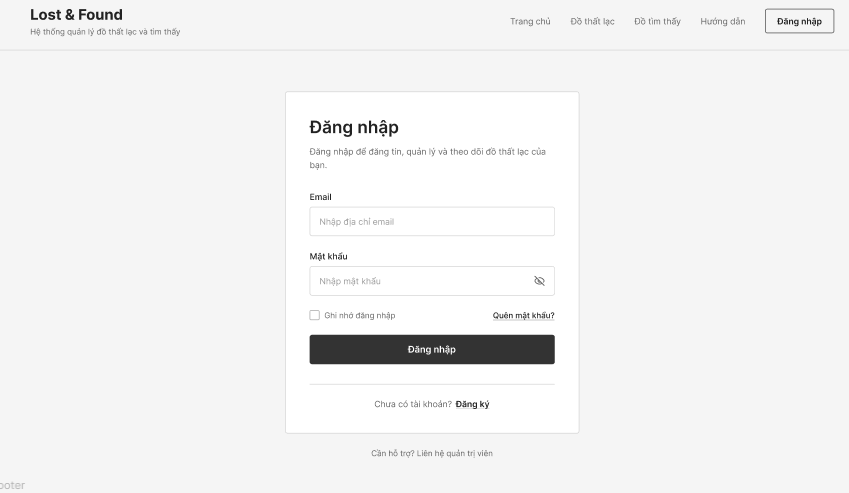

* **Bố cục chính:**
  * Header tối giản: Logo Lost & Found, slogan, thanh điều hướng (Trang chủ, Đồ thất lạc, Đồ tìm thấy, Hướng dẫn), nút CTA "Đăng nhập".
  * Form đăng nhập căn giữa trang: Trường Email, Mật khẩu (kèm icon ẩn/hiện), checkbox "Ghi nhớ đăng nhập", liên kết "Quên mật khẩu?".
  * Nút hành động chính "Đăng nhập" (solid dark button).
  * Liên kết chuyển hướng "Chưa có tài khoản? Đăng ký" và footer hỗ trợ.

---

## Screen 02 – Item Listing / Search

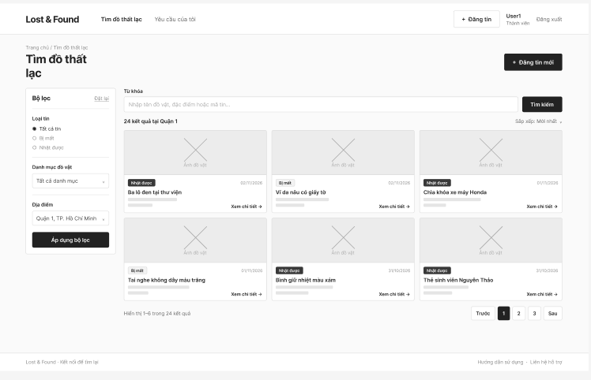

* **Bố cục chính:**
  * Header đầy đủ cho User đã đăng nhập (Profile, nút Đăng tin, Đăng xuất).
  * Khối tìm kiếm: Ô nhập từ khóa (tiêu đề, đặc điểm, mã tin) và nút "Tìm kiếm".
  * Sidebar bộ lọc bên trái: Lọc theo loại tin (Tất cả / Bị mất / Nhặt được), Danh mục đồ vật, Địa điểm, nút "Áp dụng bộ lọc" & "Đặt lại".
  * Lưới danh sách bài đăng (Grid card): Ảnh đồ vật, nhãn phân loại (Nhặt được / Bị mất), ngày đăng, tiêu đề, nút "Xem chi tiết".
  * Phân trang bên dưới (Pagination: Trước, 1, 2, 3, Sau).

---

## Screen 03 – Item Detail

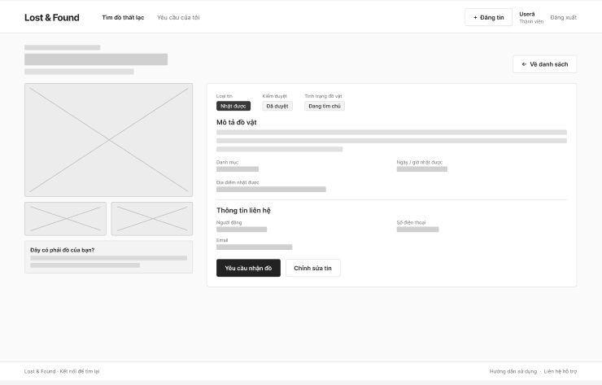

* **Bố cục chính:**
  * Nút điều hướng "← Về danh sách".
  * Cột bên trái: Gallery ảnh đồ vật (ảnh chính lớn kèm các thumbnail bên dưới), ô trạng thái "Đây có phải đồ của bạn?".
  * Cột bên phải:
    * Badge trạng thái: Loại tin (Nhặt được/Bị mất), Trạng thái duyệt (Đã duyệt), Tình trạng đồ vật (Đang tìm chủ).
    * Khối mô tả chi tiết: Nội dung mô tả, Danh mục, Thời gian nhặt/mất, Địa điểm cụ thể.
    * Khối thông tin liên hệ: Tên người đăng, Số điện thoại, Email.
    * Nút hành động: "Yêu cầu nhận đồ" (Claim), "Chỉnh sửa tin" (nếu là chủ bài).

---

## Screen 04 – Create Item

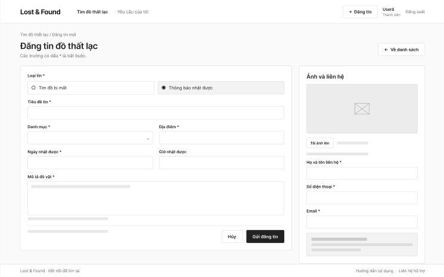

* **Bố cục chính:**
  * Form đăng tin mới chia 2 cột:
    * **Cột trái:** Loại tin (Radio: Tìm đồ bị mất / Thông báo nhặt được), Tiêu đề tin, Danh mục, Địa điểm, Ngày & Giờ, Chi tiết mô tả đồ vật.
    * **Cột phải:** Khối tải ảnh (Upload placeholder, nút "Tải ảnh lên"), Thông tin liên hệ (Họ và tên, Số điện thoại, Email), ghi chú điều khoản.
  * Nút thao tác dưới cùng: "Hủy", "Gửi đăng tin".

---

## Screen 05 – Edit Item

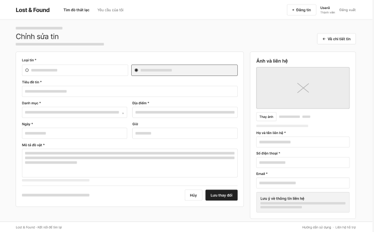

* **Bố cục chính:**
  * Giao diện tương tự màn hình Đăng tin nhưng dữ liệu cũ được điền sẵn (pre-filled).
  * Hỗ trợ thay đổi/cập nhật ảnh đồ vật ("Thay ảnh").
  * Lưu ý và cảnh báo về việc chỉnh sửa thông tin cốt lõi khi tin đã có người Claim.
  * Nút thao tác: "Hủy", "Lưu thay đổi".

---

## Screen 06 – Claim Item

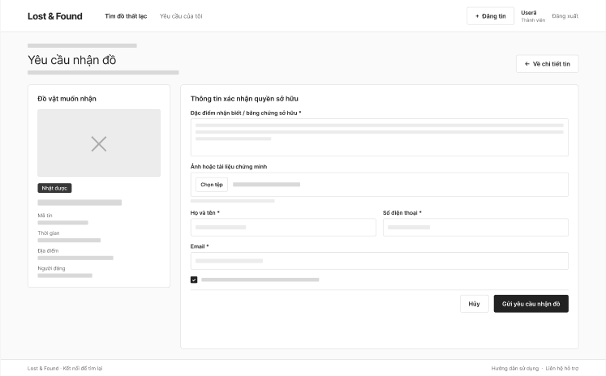

* **Bố cục chính:**
  * Cột trái: Tóm tắt thông tin đồ vật muốn nhận (Ảnh thu nhỏ, Badge, Mã tin, Thời gian, Địa điểm, Người đăng).
  * Cột phải - Form xác minh quyền sở hữu:
    * Ô nhập văn bản: Đặc điểm nhận biết / bằng chứng sở hữu (bắt buộc).
    * Upload tài liệu: Nút "Chọn tệp" để gửi ảnh hóa đơn, ảnh đối chứng.
    * Thông tin người yêu cầu: Họ tên, Số điện thoại, Email.
    * Checkbox cam kết tính xác thực của thông tin.
  * Nút thao tác: "Hủy", "Gửi yêu cầu nhận đồ".

---

## Screen 07 – Admin Panel

### Danh sách kiểm duyệt
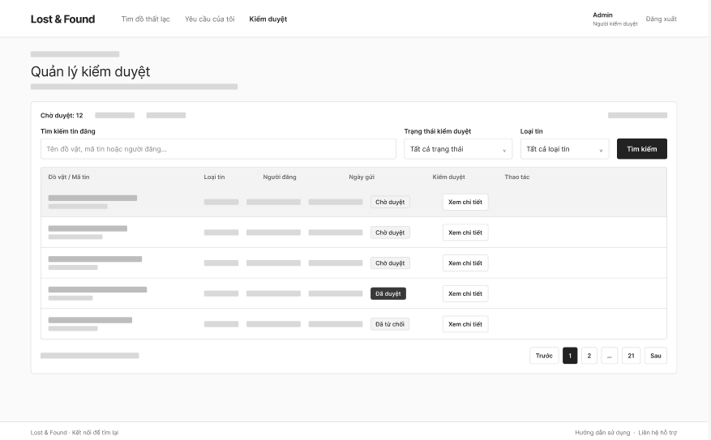

* **Bố cục chính:**
  * Thanh thống kê nhanh (Chờ duyệt, Đã duyệt, Đã từ chối).
  * Bộ lọc tìm kiếm: Từ khóa, Trạng thái kiểm duyệt dropdown, Loại tin dropdown.
  * Bảng dữ liệu (Data Table): Đồ vật / Mã tin, Loại tin, Người đăng, Ngày gửi, Trạng thái badge, Thao tác ("Xem chi tiết").

### Kiểm duyệt chi tiết
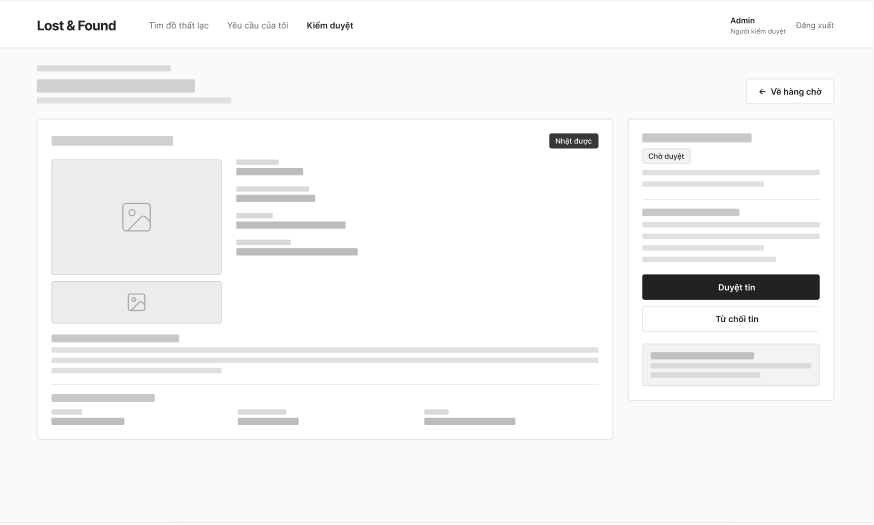

* **Bố cục chính:**
  * Khối nội dung bài đăng đầy đủ (hình ảnh đối chiếu, mô tả, vị trí, thời gian).
  * Khung điều khiển duyệt bên phải: Trạng thái hiện tại, nút hành động chính **"Duyệt tin"** và **"Từ chối tin"**.

### Modal xác nhận: Duyệt tin
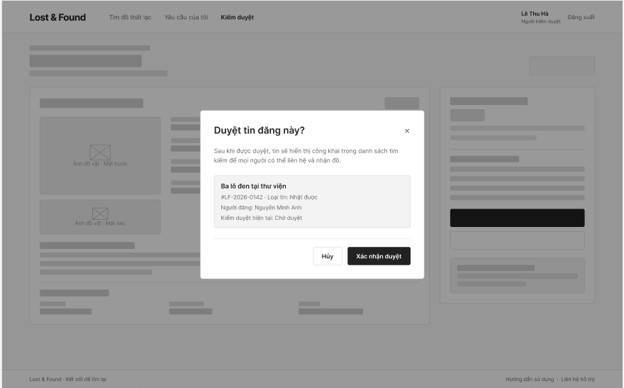

* Popup xác nhận duyệt tin công khai, hiển thị tóm tắt mã tin và người đăng. Nút "Xác nhận duyệt".

### Kết quả sau khi duyệt
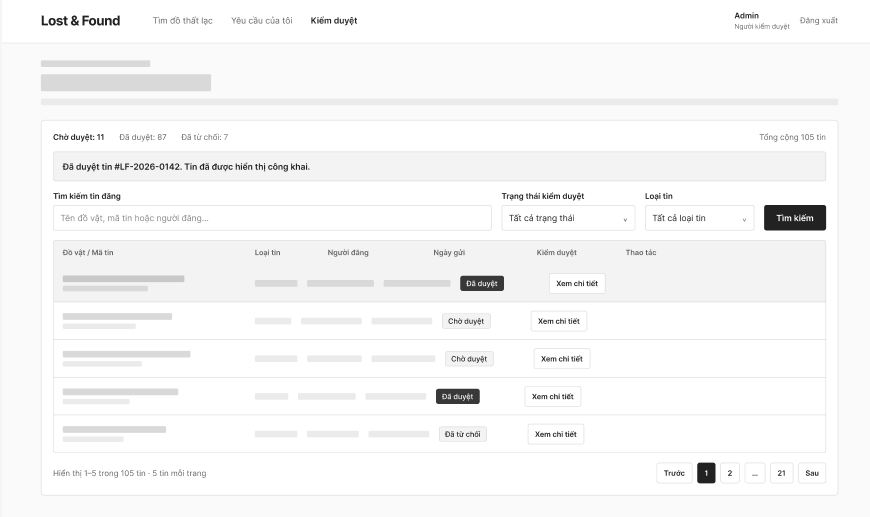

* Thông báo Alert thành công: *"Đã duyệt tin #LF-2026-0142. Tin đã được hiển thị công khai."*

### Modal xác nhận: Từ chối duyệt
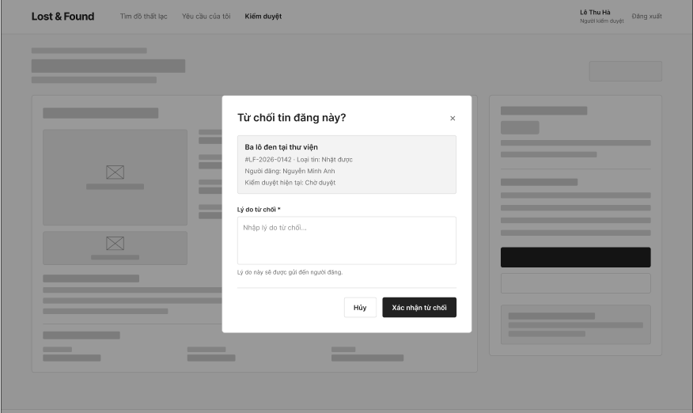

* Popup yêu cầu nhập lý do từ chối (bắt buộc) để hệ thống gửi thông báo phản hồi lại cho người đăng.

### Kết quả sau khi từ chối
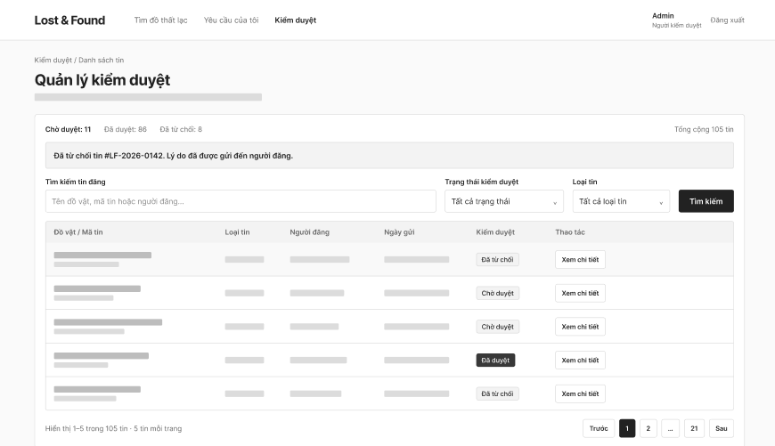

* Thông báo Alert: *"Đã từ chối tin #LF-2026-0142. Lý do đã được gửi đến người đăng."*

---

## 4. Prototype Flow

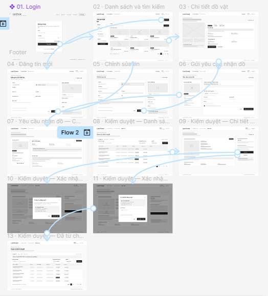

* Sơ đồ luồng liên kết giữa các màn hình từ Đăng nhập → Danh sách → Chi tiết → Đăng tin/Chỉnh sửa → Claim → Toàn bộ quy trình Kiểm duyệt của Admin.
* **Xem trực tiếp bản vẽ & tương tác:** [Figma Interactive Prototype](https://www.figma.com/design/OFpr295ZTEylvfdoKt2SSf/WireframeL-F?node-id=1-3&t=1M221cQUlrlfKxmk-1)