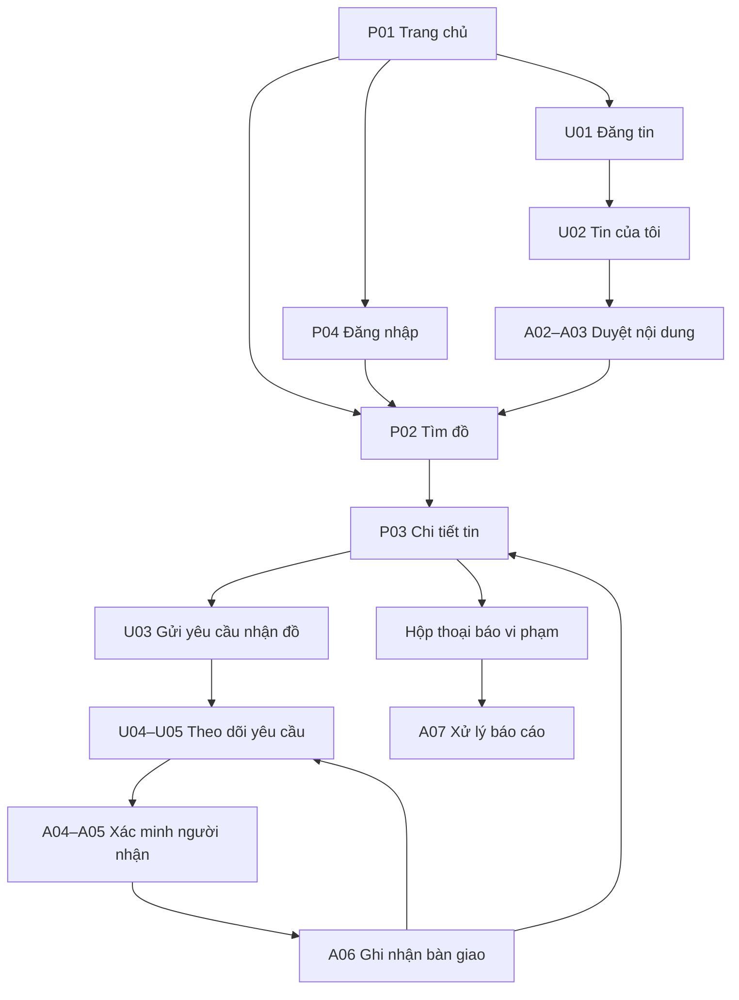

# School Lost & Found — Chức năng, trang và luồng UI/UX web

**Ngày soạn: 07/11/2026. Mục đích: đầu vào cho AI thiết kế UI/UX và TV4 dựng prototype.**

Đây là **đề xuất trải nghiệm web đầy đủ theo đề tài**, theo yêu cầu mới của nhóm trưởng; không phải xác nhận rằng toàn bộ chức năng đã được lập trình hoặc đã được duyệt vào hạn nộp. Bản này có **24 mẫu màn hình chính**, một số dùng chung bố cục cho tạo/sửa hoặc danh sách/chi tiết dạng drawer. Các hộp thoại và trạng thái lỗi được liệt kê riêng.

Tài liệu dùng để gen thiết kế: [prompt hoàn chỉnh](PROMPT-gen-UI-UX-web.md). Người phụ trách giao diện hiện tại: TV4; TV1 góp ý luồng, TV2/TV3 đối chiếu dữ liệu/API, TV5 đối chiếu trạng thái và quyền.

## 1. Căn cứ và cách đọc

Đã đối chiếu repo tại commit `f4de331d489d136da9b20a5abdd69f7fafcfc0f5`, gồm:

- [M1](../01-khoi-tao/M1-project-charter-stakeholder.md), [backlog R01–R07](../03-yeu-cau/backlog-va-nghiem-thu.md), [test plan LF-17](../03-yeu-cau/LF-17-test-plan.md).
- [LF-05: công nghệ/API](LF-05_Tech_Stack_API_GitHub_Workflow.docx).
- [LF-10: dữ liệu/auth](LF-10-mo-hinh-du-lieu-seed-auth.md) và [schema](sql/schema.sql).
- [Wireframe TV4](<Wireframe cho website Lost & Found – Hệ thống quản lý đồ thất lạc.docx>): kế thừa Login, Listing, Detail, Create, Edit, Claim và Moderation. Bổ sung đường đi rõ cho Tin của tôi, Yêu cầu của tôi, kết quả xác minh và bàn giao.

Ký hiệu **C**: chức năng tương ứng phạm vi cốt lõi trong M1/backlog; **M**: mở rộng/đề xuất cho thiết kế đầy đủ. Một trang C có thể chứa phần M được ghi rõ. C không có nghĩa đã triển khai hoặc được nghiệm thu.

M1/backlog hiện chọn bản gọn, tài khoản cấp trước, tin văn bản và xác nhận bàn giao trực tiếp. LF-05/wireframe có thêm đăng ký, ảnh, duyệt tin và nhiều bước nhận đồ. **Để prototype đầy đủ nhất quán, bản này chọn luồng có duyệt tin và xác minh trước bàn giao; đây là phương án thiết kế mở rộng.** Không trộn hai cách chuyển trạng thái trong cùng một prototype. Phần 13 ghi những điểm phải chốt trước khi nối API.

## 2. Vai trò và điều hướng

| Vai trò | Việc được làm | Điều hướng |
|---|---|---|
| Khách chưa đăng nhập | Đọc giới thiệu/hướng dẫn; trong phương án đầy đủ này, xem tin đã duyệt và thông tin công khai; đăng nhập/đăng ký | Trang chủ · Tìm đồ · Hướng dẫn · Đăng nhập |
| Sinh viên / người dùng | Đăng và quản lý tin của mình, tìm tin, gửi bằng chứng riêng, theo dõi yêu cầu/bàn giao, báo tin vi phạm | Tìm đồ · Tin của tôi · Yêu cầu của tôi · nút Đăng tin; menu tài khoản/thông báo |
| Người kiểm duyệt | Duyệt/ẩn/khôi phục tin, đọc bằng chứng để xác minh, xử lý yêu cầu và ghi nhận bàn giao, xử lý báo cáo vi phạm | Hàng đợi tin · Yêu cầu nhận đồ · Bàn giao · Báo cáo vi phạm |
| Quản trị viên | Các việc của người kiểm duyệt; quản lý tài khoản, danh mục/khu vực và xem nhật ký | Các mục kiểm duyệt + Tài khoản · Danh mục & khu vực · Nhật ký |

Người đăng tin và người yêu cầu nhận đồ đều là **người dùng**, không tạo thêm hai loại tài khoản. Tài khoản không tự chọn quyền admin lúc đăng ký. Một người có thể đăng tin mất và tin nhặt được ở những thời điểm khác nhau.

Người giữ món đồ thực tế và nơi nhận đồ cần được nhóm thống nhất; giao diện không tự ghi rằng mọi món đều đang ở phòng bảo vệ. Thông tin bàn giao riêng chỉ hiển thị cho đúng các bên liên quan và người kiểm duyệt.

## 3. Danh sách đầy đủ các trang

### 3.1 Khách và tài khoản — 7 mẫu

| ID / mức | Trang, đường dẫn đề xuất | Nội dung và chức năng | Chuyển tiếp |
|---|---|---|---|
| P01 / M | Trang chủ `/` | Giới thiệu ngắn; mascot; hai CTA “Tôi mất đồ”, “Tôi nhặt được đồ”; hướng dẫn ba bước; một số tin đã duyệt từ dữ liệu thật | Mất đồ → P02 lọc tin nhặt được; Nhặt được → U01 chọn FOUND, qua P04 nếu chưa đăng nhập |
| P02 / C | Tìm đồ `/items` | Tìm từ khóa; lọc loại Lost/Found và khu vực; xóa lọc; thẻ tin; phân trang; trạng thái rỗng. Mở rộng: danh mục, khoảng ngày, sắp xếp mới nhất | Thẻ → P03; Đăng tin → U01 |
| P03 / C | Chi tiết tin `/items/:id` | Tiêu đề, loại, mô tả công khai, khu vực, thời điểm, trạng thái; tên hiển thị người đăng. Mở rộng: ảnh công khai, gợi ý tin tương tự, báo vi phạm | FOUND còn mở → U03; tin của mình → U01 sửa; LOST của mình → đánh dấu tìm thấy |
| P04 / C | Đăng nhập `/login` | Email, mật khẩu, hiện/ẩn mật khẩu, lỗi sai thông tin, loading, đăng xuất qua menu chung | Thành công về trang đã định mở hoặc P02; người kiểm duyệt có thể vào A01 |
| P05 / M | Đăng ký `/register` | Họ tên hiển thị, email, mật khẩu/xác nhận; MSSV chỉ khi nhóm cần; validation; liên kết hướng dẫn quyền riêng tư | Thành công → P04 hoặc bước xác minh nếu nhóm chốt có xác minh email |
| P06 / M | Quên/đặt lại mật khẩu `/forgot-password`, `/reset-password` | Một mẫu hai bước: nhập email → thông báo chung; từ link hợp lệ → nhập mật khẩu mới; link hết hạn và gửi lại | Hoàn tất → P04; không hiển thị mật khẩu hoặc tiết lộ tài khoản có tồn tại |
| P07 / M | Hướng dẫn & quyền riêng tư `/help` | Cách đăng tin/tìm đồ/nhận đồ; phân biệt dữ liệu công khai và riêng; FAQ; hướng dẫn liên hệ đơn vị phụ trách khi nhóm đã có thông tin | CTA về P02/U01; liên kết sâu `/help#privacy` |

P01 không dùng số liệu giả như “10.000 món đồ đã tìm lại”. P02/P03 chỉ cho khách xem nếu nhóm chọn phương án mở rộng này; MVP M1 hiện yêu cầu đăng nhập. P06 cần dịch vụ gửi mail thật khi triển khai, không biến thông báo UI thành bằng chứng đã gửi mail.

### 3.2 Không gian người dùng — 7 mẫu

| ID / mức | Trang, đường dẫn đề xuất | Nội dung và chức năng | Chuyển tiếp |
|---|---|---|---|
| U01 / C | Tạo/sửa tin `/items/new`, `/items/:id/edit` | Một form dùng chung; chọn Mất/Nhặt được, tiêu đề, mô tả, khu vực, ngày giờ; preview/hủy/lưu. Mở rộng: danh mục, ảnh, gửi duyệt/gửi lại sau khi sửa | Gửi thành công → U02 với thông báo và trạng thái đúng; hủy → trang trước |
| U02 / C | Tin của tôi `/me/items` | Chỉ tin của mình; xem trạng thái hiển thị/nghiệp vụ riêng; mở chi tiết, sửa khi được phép; xem lý do ẩn/từ chối; LOST của mình đánh dấu tìm thấy | Chi tiết → P03 theo quyền chủ tin; sửa → U01; lý do hiển thị tại thẻ/drawer |
| U03 / C | Gửi yêu cầu nhận đồ `/items/:id/claim` | Tóm tắt tin FOUND; mô tả đặc điểm riêng để đối chiếu; giải thích ai được xem; kiểm tra điều kiện trước gửi. Mở rộng: ảnh bằng chứng riêng | Thành công → U05 với trạng thái Chờ xác minh; không báo “Đã nhận đồ” |
| U04 / C | Yêu cầu của tôi `/me/claims` | Danh sách claim của chính mình; món đồ, thời điểm, trạng thái; lọc trạng thái; không có dữ liệu người khác | Chọn yêu cầu → U05 |
| U05 / C | Chi tiết yêu cầu `/me/claims/:id` | Nội dung đối chiếu riêng, phản hồi của người kiểm duyệt, lý do từ chối, kết quả bàn giao. Mở rộng: timeline xác minh/chấp thuận, bổ sung thông tin, rút/hủy theo điều kiện, thông tin lịch/nơi bàn giao | Xem lại tin nếu còn quyền; thông tin bàn giao nằm cùng trang, không cần thêm một app/chat |
| U06 / M | Thông báo `/notifications` | Thông báo tin duyệt/từ chối/ẩn, yêu cầu cần bổ sung/chấp thuận/từ chối/bàn giao; đã đọc/chưa đọc; đánh dấu đã đọc | Mỗi thông báo dẫn đúng tin/yêu cầu; nội dung xem trước không chứa bằng chứng riêng |
| U07 / M | Tài khoản `/account` | Xem/sửa tên hiển thị và thông tin liên hệ riêng; đổi mật khẩu qua form phù hợp; đăng xuất; vai trò chỉ đọc | Lưu thành công giữ tại trang; không cho người dùng tự nâng quyền |

Tin bị ẩn vẫn thấy trong U02 bởi chủ tin. Ở U05, người gửi claim xem được claim của mình, nhưng nếu họ không còn quyền xem tin liên quan thì chỉ hiện “Tin không còn hiển thị”; không trả lại toàn bộ tin ẩn hoặc ảnh cache từ trang công khai.

### 3.3 Không gian kiểm duyệt/quản trị — 10 mẫu

| ID / mức | Trang, đường dẫn đề xuất | Nội dung và chức năng | Ai dùng |
|---|---|---|---|
| A01 / M | Tổng quan `/admin` | Số tin chờ duyệt, yêu cầu chờ xử lý, ca chờ bàn giao, báo cáo mở; mỗi thẻ dẫn hàng đợi; dữ liệu thật, không biểu đồ trang trí | Kiểm duyệt + admin |
| A02 / C+M | Quản lý tin `/admin/items` | Tìm/lọc tin, xem trạng thái; C: ẩn/khôi phục có lý do; M: hàng đợi duyệt trước khi đăng, lọc chờ duyệt/từ chối | Kiểm duyệt + admin |
| A03 / C+M | Chi tiết kiểm duyệt `/admin/items/:id` | Xem nội dung và dấu vết thao tác; C: ẩn/khôi phục; M: duyệt, từ chối có lý do; thông báo tác giả; không công khai proof claim tại đây | Kiểm duyệt + admin |
| A04 / C | Hàng đợi yêu cầu `/admin/claims` | Danh sách claim theo trạng thái/tin; số yêu cầu đang mở; nhìn được hai claim cạnh tranh nhưng chỉ xử lý từng claim | Kiểm duyệt + admin |
| A05 / C+M | Chi tiết xác minh `/admin/claims/:id` | Tin liên quan + bằng chứng riêng + người yêu cầu; từ chối hoặc xử lý bàn giao. Trong bản đầy đủ: cần bổ sung → chấp thuận → chờ bàn giao; không coi chấp thuận là trao đồ xong | Kiểm duyệt + admin |
| A06 / M | Quản lý bàn giao `/admin/handovers` | Danh sách đã chấp thuận/chờ bàn giao/đã bàn giao/đã hủy; drawer chi tiết ghi nơi/hẹn nếu có; xác nhận đã trao đồ; người thực hiện và thời gian | Kiểm duyệt + admin |
| A07 / M | Báo cáo vi phạm `/admin/reports` | Danh sách + drawer lý do/tin đích; ghi nhận, xử lý hoặc không có vi phạm; nếu cần ẩn tin, dùng hành động riêng có lý do | Kiểm duyệt + admin |
| A08 / M | Tài khoản người dùng `/admin/users` | Danh sách + drawer; tìm theo tên/email; trạng thái hoạt động; khóa/mở có lý do; cấp quyền theo chính sách; xác nhận thao tác nhạy cảm | Chỉ admin |
| A09 / M | Danh mục & khu vực `/admin/reference-data` | Hai tab; thêm/sửa/vô hiệu hóa danh mục và địa điểm; mục đang được dùng không xóa làm mất tin cũ | Chỉ admin |
| A10 / M | Nhật ký `/admin/audit` | Lọc người/thời gian/loại hành động; xem ai duyệt/ẩn/khôi phục/bàn giao; chỉ đọc; không ghi proof/mật khẩu/token vào log hiển thị | Chỉ admin hoặc quyền audit riêng |

A03 và A05 là hai nghiệp vụ khác nhau: **duyệt nội dung tin** và **xác minh người nhận đồ**. Cần có hai tiêu đề, hai nhóm hành động và hai loại trạng thái riêng, tránh nút chung “Duyệt” không rõ duyệt cái gì.

## 4. Sơ đồ điều hướng chính

Sơ đồ trình bày luồng nghiệp vụ giữa các vai trò; nó không cho sinh viên quyền mở màn hình admin. Khi khách bấm thao tác cần tài khoản, đi qua P04 rồi trở về đúng trang dự định; không bỏ mất loại tin/bộ lọc đã chọn.

## 5. Các flow phải có trong prototype

| Flow | Chuỗi thao tác | Kết quả và nhánh lỗi cần thiết kế |
|---|---|---|
| F01 — Vào hệ thống | P01 → P04/P05 → P02 | Login sai, tài khoản bị khóa, session hết hạn; đăng nhập xong trở lại thao tác đang dở |
| F02 — Tôi bị mất đồ | P01 “Tôi mất đồ” → P02 lọc FOUND → P03 → U03 → U05 | Không tìm thấy: xóa lọc hoặc tạo tin LOST ở U01; không gửi claim cho tin LOST |
| F03 — Tôi nhặt được đồ | P01/CTA Đăng tin → U01 loại FOUND → U02 chờ duyệt → A02/A03 → P02/P03 | Duyệt thì hiển thị; từ chối có lý do để chủ tin sửa và gửi lại; không đưa thông tin chứng minh sở hữu lên mô tả công khai |
| F04 — Tôi đăng tin mất | U01 loại LOST → U02 → duyệt → P03 | Sau khi tự tìm lại đồ: U02 → xác nhận “Tôi đã tìm thấy” → trạng thái Đã tìm thấy; không giả tạo claim/bàn giao |
| F05 — Xác minh nhận đồ | U03 gửi → U05 Chờ xác minh → A04/A05 → cần bổ sung hoặc chấp thuận/từ chối | Bổ sung chỉ người gửi và kiểm duyệt xem; không tự claim; không hai claim đang chờ của cùng người cho cùng tin |
| F06 — Bàn giao | A05 chấp thuận → U05/A06 Chờ bàn giao → trao đồ thực tế → A06 xác nhận → U05/P03 cập nhật | Chấp thuận giữ món đồ, chưa đánh dấu đã trả. Sau hoàn tất: một người nhận thành công; các claim còn chờ đóng/từ chối với lý do |
| F07 — Rút/hủy yêu cầu | U05 rút trước chấp thuận, hoặc đề nghị/hủy trước bàn giao theo quyền → xác nhận | Chỉ hủy hợp lệ mới giải phóng trạng thái giữ đồ. Không hủy/đảo ngược một bàn giao đã hoàn tất trong prototype |
| F08 — Kiểm duyệt nội dung | P03 báo vi phạm → A07 → A03 ẩn tin có lý do → U02 thấy lý do | Khôi phục chỉ đổi khả năng hiển thị; món đã trả không được mở lại. Báo vi phạm không tự ẩn tin |
| F09 — Theo dõi/cài đặt | Chuông → U06 → đúng U02/U05; avatar → U07/P07/đăng xuất | Không lộ proof trong notification; logout xóa dữ liệu phiên và nội dung riêng đang hiển thị |
| F10 — Quản trị nền | Admin → A08/A09/A10 | Người kiểm duyệt không tự có quyền tài khoản/danh mục; xử lý 403 khi truy cập trực tiếp |

Gợi ý ghép matching (M): với tin LOST của mình, hiển thị module “Tin có thể phù hợp” gồm FOUND; với FOUND, gợi ý LOST tương ứng. Dùng từ khóa, danh mục, khu vực, thời điểm nếu có; chỉ dùng tin đã duyệt/công khai. Gợi ý không xác minh chủ sở hữu, không tự gửi claim, không tự đặt trước món đồ và không hứa “AI nhận diện chính xác”. Không cần một trang matching riêng.

## 6. Quy tắc trạng thái cho bản thiết kế đầy đủ

Tên dưới đây là **nhãn UX/nghiệp vụ đề xuất**, chưa phải enum cuối của API.

| Đối tượng | Trạng thái và chuyển tiếp |
|---|---|
| Hiển thị tin | Chờ duyệt → Đang hiển thị hoặc Bị từ chối; Bị từ chối → sửa/gửi lại → Chờ duyệt; Đang hiển thị ↔ Bị ẩn qua người kiểm duyệt |
| Tin FOUND | Đang tìm chủ → Đang chờ bàn giao khi một claim được chấp thuận → Đã trả; hủy hợp lệ trước bàn giao → Đang tìm chủ |
| Tin LOST | Đang tìm đồ → Đã tìm thấy bởi chủ tin; không có nút gửi claim cho tin LOST |
| Claim | Chờ xác minh → Đang xác minh nếu cần bổ sung → Được chấp thuận hoặc Bị từ chối; chấp thuận → Đã nhận đồ khi có bàn giao hoàn tất; trước chấp thuận có thể Đã rút, sau chấp thuận/trước bàn giao có thể Đã hủy |
| Bàn giao | Chờ bàn giao → Đã bàn giao hoặc Đã hủy; lịch hẹn/nơi nhận là thông tin của ca bàn giao, không phải bằng chứng đã trao đồ |
| Báo cáo vi phạm | Chờ xử lý → Đang xử lý → Đã xử lý hoặc Không phát hiện vi phạm |

Hai badge trên một tin có thể là **“Bị ẩn” + “Đã trả”**. Không dùng một trường trạng thái cho cả hai ý nghĩa. Badge phải có chữ, không chỉ đổi màu.

Khi một claim được chấp thuận, các claim khác chưa được chọn vẫn chờ; các nút chấp thuận cạnh tranh bị khóa trong lúc món đồ được giữ. Khi bàn giao thực sự hoàn tất, các claim đang chờ còn lại được kết thúc với lý do rõ ràng. Nếu việc giữ đồ bị hủy hợp lệ, chúng có thể tiếp tục được xét. Backend là nơi bảo đảm quy tắc một bàn giao, UI chỉ phản ánh kết quả.

Chỉnh sửa tin: chủ tin sửa khi còn mở và không bị khóa bởi claim đang xử lý; thay đổi cốt lõi có thể yêu cầu duyệt lại trong bản mở rộng. Prototype phải thể hiện lý do không sửa được. Điều kiện khóa cụ thể cần nhóm thống nhất, vì M1/LF-05 hiện khác nhau.

## 7. Trường dữ liệu, quyền và hành động

### Form đăng tin U01

- Loại tin: Mất đồ / Nhặt được, chọn trước theo CTA đầu vào.
- Tiêu đề ngắn; danh mục (M, nhưng schema LF-10 hiện yêu cầu `category_id`); mô tả công khai; khu vực; ngày giờ mất/nhặt. Giới hạn độ dài/loại file cuối cùng lấy từ API contract.
- Ảnh công khai (M): preview, đổi thứ tự, bỏ ảnh trước gửi; lỗi file sai loại/quá lớn; không đưa giấy tờ hoặc chi tiết riêng lên ảnh công khai.
- Tên người đăng lấy từ tài khoản. Không bắt người dùng nhập lại điện thoại/email để hiển thị công khai trên mỗi tin.
- Nếu có trường đặc điểm bí mật của người nhặt được (M), đặt trong khối riêng có mô tả rõ và quyền hạn chế; không gộp vào mô tả công khai hoặc metadata ảnh.
- Nút “Gửi duyệt” trong bản đầy đủ; bản gọn đăng trực tiếp phải dùng nhãn khác. Form sửa dùng “Lưu và gửi lại” nếu thực sự cần duyệt lại, không dùng chung thông báo thành công cho mọi trường hợp.

### Form yêu cầu U03 và xử lý U05/A05

- Tin đích chỉ đọc; nhập mô tả đối chiếu bắt buộc. Ảnh bằng chứng là phần mở rộng riêng với ảnh của tin.
- Copy quyền riêng tư: “Thông tin này chỉ bạn và người kiểm duyệt được xem.” Chủ tin FOUND không tự được xem proof của người khác.
- Không yêu cầu ảnh CCCD, thẻ ngân hàng hoặc tài liệu định danh thật trong dữ liệu demo. Khi cần ảnh, dùng vật mẫu không có dữ liệu cá nhân.
- Chặn tự claim, claim tin LOST, tin ẩn ngoài quyền, tin đóng và gửi trùng đang chờ. Tin đang giữ cho một claim khác không nhận claim mới trong phương án đầy đủ này.
- Gửi thành công chỉ dẫn đến trạng thái Chờ xác minh. Khi cần bổ sung, có câu hỏi cụ thể và ô trả lời riêng; không biến thành chat công khai.
- Từ chối phải có lý do phù hợp người gửi; không tiết lộ bằng chứng hoặc danh tính người gửi claim khác.
- Xác nhận đã bàn giao cần hộp thoại nêu món đồ/người nhận, xác nhận việc trao đồ đã xảy ra; lưu người thực hiện/thời gian từ hệ thống. Người dùng thường không có quyền hoàn tất bàn giao thay admin/moderator.

### Ma trận dữ liệu hiển thị

| Nội dung | Khách/người dùng khác | Chủ tin | Người gửi claim | Kiểm duyệt/admin đúng quyền |
|---|---|---|---|---|
| Tin đã duyệt, ảnh công khai | Có theo phương án public | Có | Có | Có |
| Tin ẩn/chờ duyệt/lý do kiểm duyệt | Không | Có trong quản lý riêng | Không, trừ khi đồng thời là chủ tin | Có |
| Proof của một claim | Không | Không nếu chỉ là chủ tin | Chỉ claim của mình | Có để xác minh |
| Liên hệ/nơi hẹn riêng | Không | Chỉ nếu là bên bàn giao được chỉ định | Khi liên quan và được phép | Có để điều phối |
| Nhật ký quản trị | Không | Không | Không | Theo quyền audit |

Ẩn nút trên UI không thay thế kiểm tra quyền phía server. Khi không có quyền, phản hồi không được chứa dữ liệu riêng rồi mới che bằng CSS.

## 8. Hộp thoại và trạng thái không được bỏ sót

Hộp thoại dùng chung: bỏ thay đổi form; đánh dấu LOST đã tìm thấy; rút/hủy claim; từ chối claim có lý do; duyệt/từ chối tin; ẩn/khôi phục tin có lý do; ghi nhận đã bàn giao; báo vi phạm; khóa/mở tài khoản; đổi quyền; vô hiệu hóa danh mục. Mỗi hộp thoại có Hủy, hành động rõ nghĩa và trả focus về nút mở.

| Trạng thái | Cách thể hiện |
|---|---|
| Đang tải | Skeleton giữ bố cục, không nháy “không có kết quả” trước khi tải xong |
| Chưa có dữ liệu | Giải thích + một CTA: đăng tin/tìm đồ; mascot nhỏ |
| Tìm không thấy | Giữ từ khóa/bộ lọc; nút Xóa bộ lọc; có thể tạo tin LOST |
| Validation | Lỗi ngay dưới trường, giữ dữ liệu đã nhập, đưa focus tới lỗi đầu |
| Đang gửi | Khóa nút gửi lặp, nhãn “Đang gửi…”; giữ form |
| Lưu thành công | Toast ngắn + dữ liệu/trạng thái đã cập nhật đúng, không chỉ đổi màu nút |
| Mất mạng/lỗi máy chủ | Thử lại; giữ nội dung chưa gửi trong phiên; không tự tuyên bố thành công |
| Hết phiên | Mời đăng nhập lại, giữ đường dẫn an toàn để quay về; không lưu proof/token vào URL |
| 403 / 404 | Trang trạng thái với nút về Tìm đồ; thông báo không tiết lộ tin/claim riêng |
| 409 hoặc dữ liệu vừa thay đổi | “Yêu cầu này đã được xử lý. Vui lòng tải lại.”; refresh dữ liệu, không cho bấm bàn giao lần hai |
| Lỗi tệp (M) | Chỉ rõ ảnh lỗi, cho chọn lại; không mất phần văn bản đã nhập |
| Đã đóng/đã ẩn/đang giữ | Badge + lý do nút bị khóa; không để CTA khả dụng rồi luôn báo lỗi |

## 9. Template UI đề xuất — “Trạm đồ thất lạc”

Tên sản phẩm chính vẫn là **School Lost & Found**. “Trạm đồ thất lạc” là câu gọi thân thiện cho giao diện; không tự đổi tên đề tài hoặc gắn logo trường chưa được cung cấp.

| Thành phần | Đề xuất |
|---|---|
| Cảm giác | Dễ thương, ấm áp, gọn gàng; phù hợp sinh viên; thao tác quan trọng dễ nhận ra |
| Nền / bề mặt | Kem `#FFF9F2`, thẻ trắng `#FFFFFF` |
| Màu chính | Tím `#6D4AFF`, nút chính chữ trắng |
| Điểm nhấn | Mint `#DDF5E8`, lavender `#EEE8FF`, peach `#FFE4D6`; dùng nền trang trí/badge với chữ đậm |
| Chữ | Chính `#243247`, phụ `#566274`; font hỗ trợ dấu Việt, đề xuất Be Vietnam Pro hoặc Nunito; fallback sans-serif |
| Hình khối | Thẻ bo góc 16–20px, input/nút 10–12px, bóng rất nhẹ, viền đủ thấy |
| Nhịp bố cục | Khoảng cách theo 4/8px; nội dung tối đa khoảng 1200px; mỗi vùng có một hành động chính |
| Desktop/mobile | Thiết kế 1440px và 390px; kiểm tra 360px; danh sách 3/2/1 cột theo không gian |
| Motion | Nhẹ, ngắn; tôn trọng reduced motion; không để mascot che form/nút hoặc nhảy liên tục |

Template trang người dùng: header gọn → tiêu đề/tác vụ chính → tìm kiếm & bộ lọc → lưới thẻ → phân trang. Header có Tìm đồ, Tin của tôi, Yêu cầu của tôi, CTA Đăng tin; chuông/avatar ở cuối.

Template chi tiết: breadcrumb → phần nội dung công khai → khối trạng thái/CTA; dưới là gợi ý nếu có. Trên mobile, nút chính có thể cố định dưới cùng nhưng không che nội dung/bàn phím.

Template admin: sidebar → tiêu đề + bộ lọc → bảng/card hàng đợi → chi tiết/drawer → nhóm hành động có xác nhận. Giữ cùng màu/font với portal, giảm trang trí để đọc nhiều hồ sơ dễ hơn.

Mobile dùng bottom navigation Tìm đồ / Đăng tin / Tin của tôi / Yêu cầu; tài khoản và thông báo trong header. Bộ lọc vào drawer; bảng admin thành card có nhãn trường. Giữ trạng thái tìm kiếm khi quay lại từ chi tiết.

Khả năng sử dụng: có label thật, trạng thái focus, thao tác bàn phím, chữ khoảng 16px trong form, vùng bấm mục tiêu thiết kế tối thiểu 44px; không dùng chỉ màu để truyền trạng thái. Đặt mục tiêu tương phản chữ thường ít nhất 4.5:1 theo [W3C](https://www.w3.org/WAI/WCAG22/Understanding/contrast-minimum.html); palette đề xuất không thay việc kiểm tra từng cặp màu trong bản render.

## 10. Mascot đề xuất — Miu Tìm Đồ

Nhân vật gốc: mèo nhỏ màu kem, đầu tròn, tai bo, mắt chấm đen, má hồng nhẹ, đeo túi chéo mint và thẻ tím có biểu tượng kính lúp. Nét 2D đơn giản, cùng độ dày với icon. Tính cách nhiệt tình, bình tĩnh; không làm người mất đồ cảm thấy bị trêu.

Bốn pose đủ cho bộ UI: **chào đón** ở login/home; **cầm kính lúp** ở hướng dẫn/tìm kiếm rỗng; **ôm hộp đồ nhỏ** khi gửi tin thành công; **vẫy tay vui nhẹ** khi bàn giao hoàn tất. Khu vực xác minh/bằng chứng dùng minh họa nhỏ hoặc không dùng mascot.

Prompt tạo asset riêng:

> Create an original friendly campus lost-and-found mascot: a small round cream-colored cat, soft rounded ears, simple dark dot eyes, subtle peach cheeks, a mint crossbody bag and a tiny lavender magnifying-glass badge. Clean flat 2D vector-like illustration, consistent dark outlines, restrained pastel palette, readable at 96px, transparent background, no text, no watermark, no existing character imitation. Make four separate consistent poses: welcoming wave, searching with a magnifying glass, holding a small found-item box, and a gentle celebration after a successful return. Keep the same face, proportions, accessories and colors in every pose.

Đây là brief/prompt, **chưa phải bộ ảnh mascot đã tạo**. Illustration/icon của UI được phép là tài sản tĩnh; việc dùng mascot không đồng nghĩa đã triển khai chức năng upload ảnh đồ vật.

## 11. Bộ template/component tham khảo

| Nguồn | Dùng cho phần nào |
|---|---|
| [HyperUI](https://www.hyperui.dev/) | Bộ component Tailwind miễn phí; tham khảo card, form, navigation và bố cục app; áp lại palette/mascot của nhóm |
| [shadcn/ui](https://ui.shadcn.com/docs/components) | Nếu web dùng React: tham khảo Dialog, Drawer/Sheet, Form/Input, Tabs, Table, Skeleton; không cần dùng giao diện mặc định làm nhận diện |
| [Lucide](https://lucide.dev/) | Icon nét nhất quán cho tìm kiếm, vị trí, hộp đồ, kiểm tra, tài khoản; chỉnh màu/kích thước theo hệ thống |
| [unDraw](https://undraw.co/illustrations) | Illustration có thể đổi màu cho hướng dẫn/trạng thái trống; phương án thay thế khi chưa có mascot riêng |

Đây là nguồn component/minh họa, không phải template Lost & Found hoàn chỉnh. Chọn một hệ component chính để tránh trộn nhiều phong cách. Các trang nguồn đã được đọc ngày 07/11/2026.

## 12. Thứ tự gen để không rối

1. Gen sitemap, các flow F01–F10 và bộ màu/font/component. Kiểm tra điều hướng và quyền trước khi thêm trang trí.
2. Gen P01–P07 và U01–U02: vào hệ thống, tìm tin, đăng tin, quản lý tin.
3. Gen U03–U07 và A04–A06: claim → xác minh → bàn giao; liên kết cả phía sinh viên và người kiểm duyệt.
4. Gen A01–A03 và A07–A10: duyệt nội dung, vi phạm và quản trị nền.
5. Bổ sung mobile, trạng thái lỗi/rỗng/loading/đã đóng và các hộp thoại; kiểm tra không có nút vô tác dụng.

Dữ liệu prototype: một người nhặt được B, hai người yêu cầu A/C, một moderator M và một admin. Một tin FOUND mở có hai claim; một tin LOST mở; một tin đã trả; một tin ẩn; một tin chờ duyệt; một tin bị từ chối. Dùng dữ liệu giả có nhãn demo; bằng chứng riêng không xuất hiện trên thẻ tin, notification hoặc link công khai. Không dùng thông tin đăng nhập thật trong prompt.

Prototype cần giữ trạng thái nhất quán: admin trả đồ thì chi tiết tin, yêu cầu của người nhận và hàng đợi đều cập nhật cùng một kết quả; claim cạnh tranh không cũng “thành công”. Prototype có thể dùng mock nhưng bản nộp sản phẩm vẫn cần API/CSDL thật.

## 13. Những điểm cần chốt trước khi nối backend

| Điểm khác nhau hiện có | Hướng xử lý |
|---|---|
| M1 yêu cầu đăng nhập; LF-10 cho khách xem tin APPROVED | Prototype đầy đủ đề xuất khách xem thông tin công khai; TV1/TV2/TV3 xác nhận trước khi triển khai |
| Backlog hoãn ảnh; wireframe có ảnh và upload proof | Thiết kế ảnh là M; chỉ đưa vào bản chạy khi storage, quyền riêng tư và API sẵn sàng |
| Backlog hiển thị trực tiếp và hide/restore; wireframe có duyệt trước | Bản đầy đủ chọn duyệt trước. Bản MVP gọn phải đổi CTA/trạng thái cho khớp, không chỉ ẩn nút admin |
| Backlog claim pending/rejected/completed; LF-05 thêm verification/accepted/cancel; LF-10 dùng ACCEPTED trong thao tác bàn giao | Phải tách rõ chấp thuận và đã bàn giao. Không tự map ACCEPTED thành “Đã nhận đồ” khi chưa có dấu vết bàn giao; cần một contract duy nhất |
| FOUND returned trong backlog, CLOSED trong schema; LOST resolved/RESOLVED | Chốt mapping API → nhãn UX, không hardcode enum khác nhau ở từng trang |
| Danh mục ngoài lọc MVP, nhưng `category_id` NOT NULL trong schema | Nếu dùng schema này, form cần giá trị danh mục hợp lệ; bộ lọc danh mục có thể vẫn hoãn |
| LF-05 nêu STAFF; LF-10 dùng MODERATOR/ADMIN | Chốt role/capability với backend; không suy từ tên hiển thị “Admin” trên UI |
| Wireframe có thông tin liên hệ ở form; test plan cấm lộ proof/liên hệ riêng | Tách dữ liệu công khai và riêng; chỉ hiện liên hệ cho bên có quyền khi cần bàn giao |

Không sửa ngầm M1, backlog, schema hoặc wireframe của thành viên khác trong lần soạn này. Bản UI đầy đủ có thể dùng làm tầm nhìn sản phẩm; khi chọn phần code trước 16/11, nhóm cần ghi rõ những chức năng được triển khai và những chức năng chỉ ở prototype.

## 14. Checklist review thiết kế

- [ ] Có đủ 24 mẫu màn hình hoặc ghi rõ mẫu nào dùng chung; có đường đi quay lại và trang đích cho mọi CTA.
- [ ] Có luồng người mất, người nhặt, người kiểm duyệt; LOST không có nút claim.
- [ ] Tin của tôi và Yêu cầu của tôi là hai mục khác nhau; không trộn duyệt tin với xác minh claim.
- [ ] Claim accepted/chấp thuận chưa có nghĩa đã bàn giao; chỉ một người nhận thành công.
- [ ] Proof không xuất hiện ở trang công khai, người đăng tin, thông báo hoặc log thông thường.
- [ ] Có desktop/mobile, trạng thái lỗi/rỗng/loading/403/404/xung đột và thao tác bàn phím.
- [ ] Màu pastel có chữ đủ tương phản; mascot không che thông tin/tác vụ.
- [ ] Thành viên đã phân biệt đề xuất UI đầy đủ với phạm vi sẽ code/nộp; chưa tự ghi Approved/Done.
